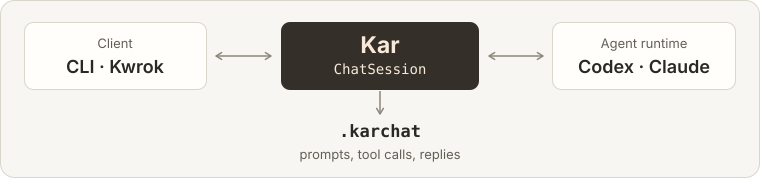

# Kar

Kar runs coding agents from a Rust library or the command line. A saved chat ties each prompt, tool call and reply to a workspace. Resume it from the terminal after a restart. Kwrok uses the same session API for its desktop workspace.

[简体中文](README.zh-CN.md) · [Quick start](#quick-start) · [Saved chats](#saved-chats) · [Integration](#integration) · [Reference](#reference)

<p align="center">
  <picture>
    <source media="(prefers-color-scheme: dark)" srcset="assets/kar-hero-dark.svg">
    
  </picture>
</p>

## Quick start

Install Kar with Cargo. The example uses the Codex CLI, installed and signed in on your machine.

```sh
cargo install --locked --git https://github.com/kense-labs/Kar.git --bin kar
```

From a project with a README, check that Kar can find Codex, then start a chat.

```sh
kar list codex --cwd .
kar chat new codex --cwd . "Read README.md and describe this project in one sentence."
```

After the command exits, continue that chat and inspect both turns.

```sh
kar chat resume "What command does the README give for running tests?"
kar chat history
```

`kar list` shows the runtimes Kar knows about. For another installed agent, use its ID in place of `codex`. Each entry reports the installation status and protocol, along with the capabilities Kar could detect.

## Saved chats

`kar chat list` shows saved chats. By default, `kar chat resume` opens the most recent one in its original workspace. To select a different one, pass its ID with `--chat`. Set `KAR_CHAT_DIR` to choose where the CLI stores its journals. To follow a desktop session from the CLI, point it at the same chat directory.

| When you want to… | Use |
| --- | --- |
| Follow a chat from a second terminal | `kar chat watch` streams events. Pass the last cursor with `--after` to reconnect. |
| Inspect a change before restoring files | Copy the turn ID from `kar chat history`, then run `kar chat changes <TURN>` or `kar chat rollback <TURN> --dry-run`. |
| Try another approach in a separate checkout | `kar chat fork <TURN> --worktree <PATH>` starts a linked worktree when the runtime supports native forking. |
| Recover after an interrupted send | `kar chat queue` shows delivery receipts. If Kar cannot confirm delivery, it marks the input uncertain and waits for a decision. |

## Integration

**Rust SDK.** Open the runtime in the project's working directory, submit a prompt and await the turn report. Add `kar` from this Git repository and enable Tokio's `macros` and `rt-multi-thread` features.

```rust,no_run
use kar::{Outcome, SessionOptions, runtime};

#[tokio::main]
async fn main() -> kar::Result<()> {
    let session = runtime("codex")?.open(SessionOptions::new(".")).await?;
    let report = session.prompt("Summarize the current diff.").await?.report().await?;
    if report.outcome == Outcome::Completed {
        println!("{}", report.text);
    }
    session.close().await
}
```

**Workbench server.** Start a local HTTP service for desktop and editor clients. The command prints its loopback address and bearer token. Clients can subscribe to chat events over SSE, share terminals, and review Git or Office changes in the same project.

```sh
kar workbench --root "$PWD" --port 4777
```

**MCP and WebAssembly.** `kar mcp --runtimes codex,claude --max-running 4` exposes a bounded agent pool over stdio. The Rust library also has a WebAssembly target for the browser-hosted Pi Durable runtime. [Host tools](src/host_tools.rs) · [Browser implementation](src/browser) · [Kwrok desktop client](https://github.com/kense-labs/kwork)

## Reference

| Topic | Read |
| --- | --- |
| Runtime protocols, setup and version-specific behavior | [Runtime reference (中文)](docs/runtime-reference.zh-CN.md) · [CLI command map](docs/backend-cli-map.tsv) |
| Native sessions, handoffs and queued input | [Agent sessions](docs/backend-workbench-agent-sessions.md) · [Handoff](docs/backend-workbench-handoff.md) |
| Building a workbench client | [HTTP endpoints](docs/backend-workbench-http-map.tsv) · [MCP tools](docs/backend-workbench-mcp-map.tsv) · [Document editing](crates/kar-documents/README.md) |
| Testing a checkout | [macOS acceptance guide](docs/backend-workbench-final-acceptance.md) · [Runtime coverage](docs/backend-source-parity.toml) |

Run `cargo test --locked --test workbench_acceptance` from a source checkout to exercise the workbench across modules.

## License

Kar's own code uses the MIT license. The Kantor Office engines use AGPL-3.0-or-later. Agent logos and the voice catalog carry their own notices. [MIT](LICENSE) · [Kantor license](https://github.com/kense-labs/kantor/blob/9b780379e32d3fa4d293499f33fbc2483655567d/LICENSE) · [Logo notices](src/brands/NOTICE.md) · [Voice catalog notice](src/workbench/voice/CATALOG-LICENSE)
