<div align="center">

<picture>
  <source media="(prefers-color-scheme: dark)" srcset="assets/kar-hero-dark.svg">
  <source media="(prefers-color-scheme: light)" srcset="assets/kar-hero-light.svg">
  
</picture>

<br/>

**English** · [**简体中文**](README.zh-CN.md) · [**Protocol Field Manual (中文)**](docs/runtime-reference.zh-CN.md) · [**macOS Acceptance**](docs/backend-workbench-final-acceptance.md)

<p>
  <code>Rust 1.89+ · Edition 2024</code> ·
  <code>#![forbid(unsafe_code)]</code> ·
  <code>20+ Agent Runtimes</code> ·
  <code>95 Scoped MCP Tools</code> ·
  <code>Native + WebAssembly</code> ·
  <code>Apache-2.0</code>
</p>

[Why Kar?](#-why-kar-exists) ·
[Architecture](#-three-concentric-engines) ·
[60-Second Quickstart](#-60-second-quickstart) ·
[Agent Fleet](#-the-agent-fleet-20-runtimes--11-protocols) ·
[Workbench Superpowers](#-autonomous-workbench-superpowers) ·
[Embed in Rust & Wasm](#-embed-in-rust--webassembly)

</div>

---

> **Every coding agent speaks a private wire dialect, hoards its own session files, and develops convenient amnesia the millisecond your terminal crashes.**
>
> **Kar** is the flight recorder, universal switchboard, and autonomous workbench built in **100% safe Rust**—so your product, CLI, or orchestrator can drive twenty different agents as if they shared one brain, one timeline, and one crash-proof ledger.

---

## ✨ Why Kar Exists

Most "agent wrappers" pipe stdout until something breaks. Kar was engineered around the ugly, real-world failure windows that happen *between* a human hitting Enter and a vendor process mutating disk:

| Everyday Disaster | Typical Wrapper | What **Kar** Actually Does |
| :--- | :--- | :--- |
| **`kill -9` mid-turn** while the agent is editing files or running a shell tool | Half-written UI state; retrying re-sends the prompt and double-runs mutations | Cross-examines the vendor's native transcript/SQLite/JSONL, backfills missing tool results by native call ID, and replays exact deltas to every SSE client via `Last-Event-ID`. |
| **Crash right after dispatch, before receipt** | Either silently drops your message or blindly fires it twice | Pins the FIFO head in `Uncertain` state until native evidence confirms or the user decides—never letting queued messages leapfrog out of order. |
| **Server restarts while the model was asking you a question** | Question vanishes; session hangs or loses context | Converts eligible root questions into durable `OrphanedQuestion` cards visible across reconnecting clients (answerable once as a new turn or dismissible), while strictly expiring stale permission prompts. |
| **You want Claude to plan, Codex to grind tests, and Qwen to summarize** | Copy-paste Markdown between three terminals | Same-chat **native handoff** (`POST /handoffs`) transfers bounded history, tool outputs, and `SessionSettings` mid-thread—or forks Turn #2 into a linked Git worktree while Turn #3 keeps running. |
| **Foreground turn ends, background shell keeps running** | Orphaned zombie processes or blind `pkill` collateral damage | Tracks per-session process trees & detached process groups (`Claude`, `Antigravity`, `OpenCode`, `Cursor ACP`), supporting targeted `await` and surgical single-session `stop`. |
| **Agents need to edit real specs, spreadsheets & decks—not just `.rs`** | "Please export to CSV first" | Built-in pure-Rust **Kantor** engines co-edit `.md`, `.docx`, `.xlsx`, and `.pptx` concurrently with human saves, auto-merging compatible edits and surfacing `409` revision disputes. |

---

## 🧭 Three Concentric Engines

Use as little or as much of Kar as you need—from a zero-daemon Rust library call up to a full multi-client HTTP/SSE/MCP workbench:

```mermaid
flowchart LR
    subgraph Fleet["20+ Coding Agent Runtimes"]
        direction TB
        A1["Codex · Claude Code · Cursor"]
        A2["Antigravity · OpenCode · Pi"]
        A3["Kimi · Grok · DSH · Qwen"]
        A4["Factory · Devin · Kiro · Morph · Wasm"]
    end

    subgraph L1["1 · Runtime SDK (kar)"]
        direction TB
        S1["Unified Session · Allow & Host Questions"]
        S2["Pre-Chat Inventory · Shared Pool · PiDurable"]
        S3["VoyageRecorder · ScriptedRuntime · Harbor"]
    end

    subgraph L2["2 · Durable Chat & Git Time-Machine"]
        direction TB
        C1[".karchat Journal + CRC32 WAL Store"]
        C2["Per-Turn Git Trees (gix) & Worktree Restore"]
        C3["Quota Hold & Auto-Resume (UsageLimitRecovery)"]
    end

    subgraph L3["3 · Autonomous Workbench"]
        direction TB
        W1["Scoped MCP Tools · Cross-Env · Outbound Webhooks"]
        W2["SSH Workspaces · Tailscale · macOS Telemetry"]
        W3["TextGeneration · Stack Merge · Self-Hosted Forge"]
        W4["Keychain / 1Password Vault · GB18030 · Voice VAD"]
    end

    Fleet <--> L1 --> L2 --> L3
```



---

## 🚀 60-Second Quickstart

### 1. Build & Recon Your Machine

```sh
cargo build --release --locked

# Discover every installed agent binary, version, shadowed PATH copies & capabilities
./target/release/kar list

# Run a one-shot turn with Codex (or claude, cursor, opencode, pi, kimi, grok, qwen, dsh...)
./target/release/kar run codex "Map out the architecture of this repository" --cwd .
```

### 2. Durable, Crash-Resilient Chats & Time-Travel

```sh
# Start a persistent chat bound to this workspace (survives terminal & host restarts)
kar chat new claude --cwd . "Refactor the parser and add property tests"

# Resume from anywhere—even if the previous controller was SIGKILL'd mid-turn
kar chat resume "Now benchmark the hot path"

# Ask a zero-pollution side question on a temporary native fork (Claude 2.1.326+)
kar chat ask "Why did you pick an arena allocator here?" --chat "$CHAT_ID"

# Replay a recorded session into logical user/automation attempts & native echoes
kar replay run.jsonl --conversation
```

### 3. Launch the Full Local Workbench Server

```sh
kar workbench --root "$PWD" --port 4777
```

Outputs a loopback URL and `Bearer` token serving projects, resumable SSE chat feeds, rich visible-text search, shared PTY terminals, stacked PR actions, workflows, Office co-editing, and scoped MCP endpoints.

---

## 🤖 The Agent Fleet (20 Runtimes · 11 Protocols)

Kar speaks each agent's **highest-fidelity native protocol** rather than scraping ANSI terminal text:

| Wire Protocol | Built-in Runtimes | Standout Capabilities in Kar |
| :--- | :--- | :--- |
| **Codex `app-server`** | `codex` | Native turn fork (even while parent turn is busy), file/network resource grants, goals, structured output, quota reset redemption, abort process-tree cleanup, native doc co-edit |
| **Claude `stream-json`** | `claude` | Mid-turn image steering & coalesced follow-ups, `AskUserQuestion` forms, context breakdown, `last_model_request` inspection, zero-pollution `side_question`, interactive limit-reset driver |
| **ACP (`JSON-RPC / stdio`)** | `cursor`, `antigravity`, `opencode`, `grok`, `devin`, `kiro`, `fx`, `codebuddy` (+ dynamic ACP registry) | Parameterized model/effort menus, Cursor detached-group background shell wait/stop & subagent attribution, Antigravity image steering & quota countdowns, Grok hosted PTY cleanup, OpenCode `v1`/`v2` release lines |
| **Pi `RPC` + `Pi Durable` (Wasm)** | `pi`, `PiDurable` | Offline-by-default package preflight, turn-exact `clone`/`fork`, Node SDK registered tool & 1,699-model catalog inspection, plus **in-browser WebAssembly + IndexedDB** harness |
| **DeepSeek Harness (`Web` / `ACP`)** | `dsh` | Sequenced native Web/WS transport, per-session sandbox `--add-dir`, `--session-log-upload off` verification, native goals, background Bash/PowerShell job stop |
| **Kimi `KAP` / `ACP`** | `kimi` | Automatic KAP (HTTP + WS) vs ACP negotiation, shared OAuth lock refresh, agent-attributed token accounting, crash recovery from completed native turns |
| **Factory `stream-jsonrpc`** | `factory` | Native `droid` catalog, interactive questionnaires & editable plan approval (`proceed_edit`), account + Droid Core quota windows, JSONL crash recovery |
| **Qwen `SDK channel`** | `qwen` | Private ACP provider setup (`openai`/`anthropic` endpoints), `--native-memory-default off` isolation, effort menus, streaming parallel tool attribution |
| **Muse `serve`** | `muse` | Autonomous background turns, post-turn background subagent approvals, usage & chat lifecycle |
| **Qoder `worker` / `daemon`** | `qoder` | Version-aware worker (`1.1.78+`) vs per-session SDK daemon (`1.1.81+`), UUID-correlated manual compaction |
| **Remote & Console Engines** | `morph`, `cybion` | Shared local **Mister Morph** Console lifecycle with `morph_reattached` live recovery; remote **Cybion** Worker threads with clean lease-release vs process-exit separation |

---

## 🛠️ Autonomous Workbench Superpowers

When running `kar workbench`, models and human clients collaborate through a tightly permissioned control plane:

- **🧰 Scoped Model MCP Tools (`16` Toolkits + `tool_search` + Standard `annotations`/`_meta`)** — Complete typed JSON Schemas across all tools, including child delegation (`kar_delegate_task` inheriting the parent chat's active checkout branch and supporting up to 64 sub-repositories), cross-environment `environment_id` forwarding, cross-thread `fork` / `merge_back`, worktree handoffs, GitHub/GitLab/Forgejo/Bitbucket/Azure/Linear issues & PRs, previews, devices, and durable workflows—gated by live `Plan` vs `Execute` chat grants.
- **🔐 Unified Pure-Rust Secret Vault (AES-256-GCM + macOS Keychain + Batched 1Password `op inject`)** — Encrypts `/server/secrets`, peer environment tokens, issue tracker credentials, relay tokens, and per-host Git Forge PATs on disk, while batching multiple `op://` references into a single `op inject` invocation per account so Touch ID only unlocks once.
- **⚡ Framed CRC32 WAL Persistence, Cached Fuzzy Search Index & Automated Storage GC** — `projects.wal` / `workflows.wal` incremental write-ahead logs with automatic checkpoint compaction, invalidation-aware `WorkspaceSearchIndex`, GBK/GB18030 Chinese source file fallback decoding, and policy-driven `WorktreeCleanupRules` with transparent missing-worktree re-materialization on reopen.
- **✍️ Built-In `TextGeneration` & Stacked PR Merges** — Native OpenAI-compatible and Anthropic HTTP drivers with multi-agent fallback power first-turn auto thread titles, `sourceControlWritingStyle`-aware commit messages, PR template descriptions, semantic branch names, Claude/Codex review guides, and streaming VAD `/ws/voice` filler cleanup; `kar_pull_request` `stack: true` merges entire PR stacks in order alongside automatic self-hosted Forgejo/GitLab/GHES discovery.
- **🌐 SEP-3415 Outbound MCP Event Webhooks, SSH Remote Workspaces & macOS Operations** — `events/subscribe` outbound `whsec_` HMAC-SHA256 webhooks with full private/loopback IP blocklist and DNS-rebinding-safe resolution (plus secret rotation dual-signing), OpenSSH `ControlMaster` remote workspace tunnels, Tailscale Serve HTTPS discovery (filtering cloud `169.254.169.254` fake-LAN IPs), `UsageLimitRecoveryWorker` quota hold & auto-resume, W3C OTLP traces & macOS battery/thermal telemetry, and `kar service` (`launchd`), `kar up`, `kar doctor`, `kar triage`, `kar policy`, and `kar harbor`.
- **🔎 What-You-See Thread Find (`thread-find`)** — Two-phase thread search indexes rendered Markdown, workspace-disambiguated file chips (`src/mod.rs` vs `tests/mod.rs`), line ranges (`L42–64`), `(kar|t3)-citation://v1/` quote annotations, `<details>` blocks, and `<picture>` theme variants—without false-matching hidden raw URLs.
- **🖥️ Multi-Viewer PTY & Dev Previews** — Real `portable-pty` + `vt100` terminal sessions negotiate minimum grid dimensions across active viewers, elect a single device-query responder, and pair with authenticated localhost/Chromium/Simulator/Emulator previews.
- **🌿 Stacked Git & Forge Watches** — Stage, run local Git hooks with live SSE output, push to `origin` or fork `publication` remotes, open/reuse cross-repo `fork -> upstream` PRs, track per-commit `reviewed` files, and auto-wake the owning chat when CI fails or new review comments land.
- **⚡ Durable Workflows, Milestones & Signed Webhooks** — Multi-step `agent` / `script` / nested `workflow` / timeout-bounded `ask` / `wait_signal` pipelines, 12 resumable external MCP milestone event types (`parentWorkflowRunId`, `expired`, `stopped`, `skipped`), and HMAC-verified webhooks with replay deduplication and `410 Gone` delivery-age enforcement.
- **📑 Headless Markdown & Kantor Office Co-Editing** — Concurrent human + agent editing on `.txt`, `.md`, `.docx`, `.xlsx`, and `.pptx` over `/projects/{p}/documents`, with paragraph/cell/shape-level merges and persistent conflict resolution receipts.
- **🤝 Device Pairing, Guest Shares & Cloudflared Relay** — Short-lived pairing codes, revocable device Bearer tokens, read/propose guest links (owners review & accept guest image proposals into native turns), and digest-verified `cloudflared` tunnel orchestration.

<details>
<summary><b>📋 Expand: CLI Swiss-Army Knife Cheat Sheet</b></summary>

<br/>

| Command | What It Does |
| :--- | :--- |
| `kar list [runtime] --cwd .` | Inspect resolved binaries, shadowed PATH duplicates, release lines (`InstallLine`), and pre-open `session_capabilities` |
| `kar orient --depth full --cwd .` | One-shot parallel probe of installations, auth status, models, quotas, and workspace customizations |
| `kar install opencode --line v2 --plan --json` | Preflight host installer plan (or omit `--plan` to execute and verify post-install version receipt) |
| `kar update [runtime] --check --json` | Check or run native vendor updaters across one or all installed runtimes |
| `kar account <runtime> login \| status \| usage` | Run native OAuth/device login, verify auth state, or read pre-chat rate-limit windows & reset credits |
| `kar providers <opencode\|pi\|qwen> menu` | Manage multi-provider API keys, OAuth flows, and Pi's 43-provider / 1,699-model catalog |
| `kar skills \| mcp-servers \| tools \| commands --cwd .` | Query workspace skills, MCP servers, tool schemas, and slash commands *before* opening a chat |
| `kar chat new \| resume \| fork \| compact \| watch` | Full durable `.karchat` lifecycle from any directory |
| `kar mcp --runtimes codex,claude --max-running 4` | Expose a bounded pool of local coding agents as an MCP server over stdio |
| `kar workbench --root "$PWD" --port 4777` | Start the full authenticated HTTP / SSE / WebSocket / MCP workbench server |
| `kar up` / `kar service install --root "$PWD"` | Run supervised workbench in foreground or manage macOS `~/Library/LaunchAgents` `launchd` service |
| `kar doctor` / `kar policy` / `kar triage` | Run macOS environment health diagnostics, inspect enterprise `ManagedPolicy`, or export triage bundles |
| `kar harbor init \| run \| status \| audit` | Run multi-agent budget-capped soak supervisor, live contract auditor, and automatic session reaper |

</details>

---

## 🦀 Embed in Rust & WebAssembly

### 1. Drive Any Agent in 10 Lines of Safe Rust

```toml
[dependencies]
kar = { git = "https://github.com/kense-labs/Kar.git" }
tokio = { version = "1", features = ["macros", "rt-multi-thread"] }
```

```rust,no_run
use kar::{Outcome, SessionOptions, runtime};

#[tokio::main]
async fn main() -> kar::Result<()> {
    let session = runtime("codex")?.open(SessionOptions::new(".")).await?;
    let turn = session.prompt("Summarize the module graph in three bullets.").await?;
    let report = turn.report().await?;
    if report.outcome == Outcome::Completed {
        println!("{}", report.text);
    }
    session.close().await
}
```

### 2. Expose In-Process Rust Functions as Native MCP Tools

Give any local agent (`codex`, `claude`, `grok`, `pi`, `qwen`, `kimi`, `factory`...) live access to your Rust application's state—with hot-swappable tool lists (`notifications/tools/list_changed`) and per-call cancellation:

```rust,no_run
use kar::{SessionOptions, host_tools::HostTool, serve_mcp_tools};
use serde_json::json;

# async fn host_tools_demo() -> kar::Result<()> {
let schema = json!({
    "type": "object",
    "properties": { "symbol": { "type": "string" } },
    "required": ["symbol"]
});
let lookup = HostTool::new(
    "lookup_symbol",
    schema.as_object().unwrap().clone(),
    |args, _cancel| async move {
        let sym = args["symbol"].as_str().ok_or("missing symbol")?;
        Ok(format!("Resolved definition for {sym}").into())
    },
);

let host = serve_mcp_tools("my-ide", vec![lookup], None).await?;
let mut opts = SessionOptions::new(".");
opts.mcp_servers.extend([host.entry()]);

let session = kar::runtime("claude")?.open(opts).await?;
# session.close().await?;
# host.close().await;
# Ok(())
# }
```

### 3. Subscribe to Crash-Proof HTTP/SSE Replicas (or Compile to Wasm)

```rust,no_run
# async fn replica_demo(chat_url: &str) -> kar::Result<()> {
let mut feed = kar::chat::HttpChatFeed::new(chat_url)?;
let mut replica = kar::chat::ChatReplica::from_snapshot(feed.snapshot().await?);

loop {
    let event = feed.recv(replica.cursor()).await?;
    replica.apply(event)?;
}
# }
```

The exact same `kar` crate also compiles to `wasm32-unknown-unknown` to drive **Pi Durable** directly inside Chromium + IndexedDB:

```sh
cargo build --lib --release --locked --target wasm32-unknown-unknown
wasm-bindgen --target web --out-dir target/browser target/wasm32-unknown-unknown/release/kar.wasm
```

---

## 🧪 Verification & Engineering Rigor

Kar enforces `#![forbid(unsafe_code)]` across the entire crate and ships with deterministic protocol peers, crash-window simulators, Kantor Office fixtures, and static upstream parity checkers:

```sh
# Format, lint, unit tests, doctests & full offline integration suites
cargo fmt --all -- --check
cargo clippy --locked --all-targets -- -D warnings
cargo test --locked

# Cross-module end-to-end workbench acceptance (PR worktree -> 2-client SSE -> Codex/Qwen handoff
# -> PTY preview -> Markdown & Word/Excel/PPT co-edit -> Git/PR -> Webhook -> Guest -> Restart)
cargo test --locked --test workbench_acceptance

# Static parity & assertion coverage verification
rustc --edition=2024 -D warnings tools/backend-coverage.rs -o /tmp/kar-coverage && /tmp/kar-coverage
```

Deep per-vendor version notes, live binary trial flags (`--ignored`), and protocol edge cases are documented in:

- 📖 [**Per-Vendor Protocol & Version Field Manual (`docs/runtime-reference.zh-CN.md`)**](docs/runtime-reference.zh-CN.md)
- 🧭 [**macOS Unified Workbench Acceptance (`docs/backend-workbench-final-acceptance.md`)**](docs/backend-workbench-final-acceptance.md)
- 🗂️ [**Runtime & Workbench Parity Ledger (`docs/backend-source-parity.toml`)**](docs/backend-source-parity.toml)

---

<div align="center">

Built with obsessive care in **100% Safe Rust** · Licensed under **Apache-2.0**

[**⬆ Back to Top**](#) · [**切换到简体中文 →**](README.zh-CN.md)

</div>
