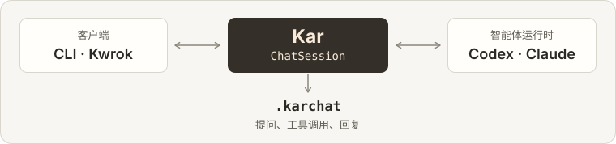

<div align="center">

<picture>
  <source media="(prefers-color-scheme: dark)" srcset="assets/kar-hero-zh-dark.svg">
  <source media="(prefers-color-scheme: light)" srcset="assets/kar-hero-zh-light.svg">
  
</picture>

<br/>

[**English**](README.md) · **简体中文** · [**各供应商协议细节手册**](docs/runtime-reference.zh-CN.md) · [**macOS 综合验收指南**](docs/backend-workbench-final-acceptance.md)

<p>
  <code>Rust 1.89+ · Edition 2024</code> ·
  <code>#![forbid(unsafe_code)]</code> ·
  <code>20+ 编程 Agent 运行时</code> ·
  <code>95 项模型 MCP 工具</code> ·
  <code>Native + WebAssembly</code> ·
  <a href="LICENSE"><code>MIT</code></a>
</p>

[为什么需要 Kar](#-为什么需要-kar) ·
[三层同心引擎](#-三层同心引擎架构) ·
[60 秒上手](#-60-秒快速上手) ·
[全阵容运行时](#-全阵容运行时矩阵20-种-agent--11-种原生协议) ·
[工作台超能力](#-自治工作台核心超能力) ·
[嵌入 Rust 与 Wasm](#-嵌入你的-rust-后端与浏览器-wasm)

</div>

---

> **每个编程 Agent 都在讲自己的私有方言、把会话锁在各自的隐藏目录里，而且只要终端一崩就当场失忆。**
>
> **Kar** 是用 **100% 安全 Rust（`#![forbid(unsafe_code)]`）** 打造的**飞行记录仪、万能调度台与自治工作台**——让你的桌面端、Web IDE、CLI 或多智能体编排器用同一套接口驾驭二十余种本地与远端 Agent：跨崩溃不丢一帧、不重发一次请求、随时按回合回退工作区，还能在同一条对话里让不同模型无缝接力。

---

## ✨ 为什么需要 Kar？

市面上大多数「Agent 封装层」只是在顺风局转发标准输出；而 **Kar** 专门死磕那些「按下回车之后、落盘之前」最致命的真实故障窗口：

| 真实工程灾难现场 | 普通封装层的结局 | **Kar** 的处理方式 |
| :--- | :--- | :--- |
| **回合中途 `kill -9` 强杀**（Agent 刚跑完工具、UI 还没来得及记账） | 界面半截残废；一重试就把原 Prompt 再发一遍，脚本被执行两次 | 重启后自动比对供应商原生转录（SQLite / JSONL / RPC 历史），按原生调用 ID 原位补齐缺失回复与工具输出，并通过 `Last-Event-ID` 游标向所有断线客户端无重无漏补推。 |
| **刚发给供应商、还没拿到回执就断电/崩溃** | 要么悄无声息吞消息，要么盲目重投扣双倍额度 | 将证据不足的队首锁定在 `Uncertain` 待确认态，严禁后续排队输入越过队首乱序抢跑，交由用户或明确原生回执裁决。 |
| **模型刚向你提问，你还没回答服务就重启了** | 提问彻底蒸发，会话卡死或上下文断裂 | 将符合条件的根会话普通提问持久化转为 `OrphanedQuestion`（多端重连一致可见，可作为新回合回答一次或显式关闭），同时严格剔除已失效的权限/机密审批请求。 |
| **想让 Claude 先做架构规划、Codex 接手改代码跑测试、Qwen 最后写总结** | 在三个终端之间来回复制粘贴 Markdown | 支持**同聊天原生交接（`POST /handoffs`）**，保留完整 `SessionSettings`、工具证据与有界上下文；也可在父会话仍在跑第 3 轮时，直接从第 2 轮分叉到独立 Git 工作树并行探索，最后 `merge_back` 合回。 |
| **前台回合早已结束，Agent 拉起的后台命令还在跑** | 变成无人认领的僵尸进程，或粗暴 `pkill` 误杀隔壁会话 | 按会话追踪进程树与脱离进程组（`Claude`、`Antigravity`、`OpenCode`、`Cursor ACP`），支持阻塞等待（`await`）、外科手术式单会话停止（`stop`）与 `shell_id` 跨轮复用隔离。 |
| **不仅要改代码，还要跟人类一起改方案文档、表格和 PPT** | 「请先把内容导出成纯文本」 | 内置纯 Rust **Kantor** 文档引擎，支持人类与 Agent 并发双写 `.md`、`.docx`、`.xlsx`、`.pptx`——兼容修改自动结构化合并，竞争修改生成持久 `409` 冲突仲裁单。 |

---

## 🧭 三层同心引擎架构

你可以只把 `kar` 当作轻量无守护进程的 Rust 库调用，也可以一键启动完整的 HTTP / SSE / WebSocket / MCP 自治工作台：

```mermaid
flowchart LR
    subgraph Fleet["20+ 编程 Agent 运行时"]
        direction TB
        A1["Codex · Claude Code · Cursor"]
        A2["Antigravity · OpenCode · Pi"]
        A3["Kimi · Grok · DSH · Qwen"]
        A4["Factory · Devin · Kiro · Morph · Wasm"]
    end

    subgraph L1["第一层 · 统一运行时 SDK (kar)"]
        direction TB
        S1["统一会话控制 · Allow 无人值守 · Host 独立提问"]
        S2["开聊前探测 · Shared 共享池 · PiDurable 原生引擎"]
        S3["VoyageRecorder 录制 · Scripted 测试桩 · Harbor 审计"]
    end

    subgraph L2["第二层 · 持久聊天与 Git 时光机"]
        direction TB
        C1[".karchat 账本 + CRC32 增量 WAL 存储"]
        C2["逐回合 Git 树快照 (gix) · 缺失工作树自动重建"]
        C3["额度耗尽自动挂起与到点唤醒 (UsageLimitRecovery)"]
    end

    subgraph L3["第三层 · 自治工作台服务 (Workbench)"]
        direction TB
        W1["会话级授权 MCP · 跨环境转发 · 出站事件 Webhook"]
        W2["SSH 远程工作区 · Tailscale 发现 · macOS 实时遥测"]
        W3["TextGeneration 六合一 · 整栈 PR 合并 · 自建托管探测"]
        W4["Keychain / 1Password 机密库 · GB18030 · 流式语音"]
    end

    Fleet <--> L1 --> L2 --> L3
```



---

## 🚀 60 秒快速上手

### 1. 编译并一键摸底本机安装的 Agent

```sh
cargo build --release --locked

# 自动发现本机所有已安装 Agent、PATH 遮蔽副本、可选发行线及会话前能力声明
./target/release/kar list

# 直接在当前仓库跑一轮任务（可替换为 claude, cursor, opencode, pi, kimi, grok, qwen, dsh...）
./target/release/kar run codex "读一下本项目，梳理核心模块之间的数据流" --cwd .
```

### 2. 跨重启持久聊天、零污染旁路提问与对话回放

```sh
# 创建绑定当前工作区的持久聊天（终端关掉、机器重启后随时在任意目录续聊）
kar chat new claude --cwd . "重构解析器并补齐边界测试"

# 默认恢复最近一次聊天；即使上次进程被强杀也会先与原生记录对账补全
kar chat resume "顺着刚才的改动继续检查性能热点"

# 在临时原生分叉里提一个「零污染」旁路问题——不触发工具、不污染主聊天历史（Claude 2.1.326+）
kar chat ask "刚才为什么选择这种锁粒度？" --chat "$CHAT_ID"

# 从原始录制文件完整还原每条输入的排队、撤回、重投、输入来源与原生回显
kar replay run.jsonl --conversation
```

### 3. 启动本地全栈自治工作台

```sh
kar workbench --root "$PWD" --port 4777
```

启动即输出本机回环地址与 `Bearer` 访问令牌，一站式提供项目工作树管理、双端断点续传 SSE、所见即所得富文本查找、多端共享 PTY、Stacked PR 发布、持久工作流、Word/Excel/PPT 协同编辑及外部 MCP 里程碑流。

---

## 🤖 全阵容运行时矩阵（20 种 Agent · 11 种原生协议）

Kar 拒绝脆弱的终端字符刮取，始终对接各家供应商**最高保真度的原生结构化协议**：

| 底层通信协议 | 内置运行时标识 | Kar 深度适配的代表能力 |
| :--- | :--- | :--- |
| **Codex `app-server`** | `codex` | 父聊天繁忙时按已完成回合原生分叉、文件与网络细粒度授权、原生目标（Goals）、结构化输出、幂等兑换额度重置、中止回合自动清理子进程树、原生私有副本协同改文档 |
| **Claude `stream-json`** | `claude` | 回合中带图插话与跨轮合并追踪、`AskUserQuestion` 交互表单、上下文构成拆解（`context_breakdown`）、脱敏原生请求体观测、零污染 `side_question`、交互式周/五小时额度重置驱动 |
| **ACP（`JSON-RPC / stdio`）** | `cursor`、`antigravity`、`opencode`、`grok`、`devin`、`kiro`、`fx`、`codebuddy`（及第三方 ACP 注册表） | 参数化模型与推理强度菜单、Cursor 脱离进程组后台命令等待/定向停止与子代理归属、Antigravity 同轮带图插话与额度倒计时、Grok 托管终端清理、OpenCode `v1`/`v2` 双发行线安装 |
| **Pi `RPC` + `Pi Durable` (Wasm)** | `pi`、`PiDurable` | 默认离线包预检、精确到回合锚点的 `clone`/`fork`、43 家供应商与 1,699 个模型目录刷新，以及**同一套 Rust 源码直编 WebAssembly 在浏览器 + IndexedDB 内运行** |
| **DeepSeek Harness（`Web` / `ACP`）** | `dsh` | 带序号原生 Web/WebSocket 流、会话级沙箱可写目录 `--add-dir`、启动前核实 `--session-log-upload off`、原生目标续跑、定向停止后台 Bash/PowerShell 作业 |
| **Kimi `KAP` / `ACP`** | `kimi` | 按版本自动择优 KAP（HTTP + WS）或 ACP、并发共享一次原生 OAuth 刷新、按子代理归属统计 Token、从已结束原生回合无损恢复 |
| **Factory `stream-jsonrpc`** | `factory` | 原生 `droid` 目录查询、多选问卷与可编辑计划审批（`proceed_edit`）、账号与 Droid Core 双重额度窗口、JSONL 原生转录崩溃补全 |
| **Qwen `SDK channel`** | `qwen` | 零模型请求的私有 ACP 供应商配置写入、`--native-memory-default off` 默认记忆隔离、推理强度菜单、并行流式工具块归属 |
| **Muse `serve`** | `muse` | 原生自主发起回合、父回合结束后的后台子代理审批流、用量读取与普通聊天恢复 |
| **Qoder `worker` / `daemon`** | `qoder` | 按 CLI 版本自动路由 `worker`（`1.1.78+`）或独立 `SDK daemon`（`1.1.81+`），按命令 UUID 严格关联手动压缩边界 |
| **共享控制台与远端 Worker** | `morph`、`cybion` | 多会话共享本机 **Mister Morph** Console 并在重启后原位重挂运行中任务（`morph_reattached`）；接入远端 **Cybion** 线程并严格区分释放本地租约与远端退出 |

---

## 🛠️ 自治工作台核心超能力

通过 `kar workbench` 启动服务后，人类客户端与模型会话将在同一套权限边界内协同工作：

- **🧰 会话级授权模型 MCP 工具（16 大业务组 + `tool_search` + 标准 `annotations`/`_meta`）** — 全量强类型 JSON Schema，支持子任务委派（`kar_delegate_task`，自动继承父聊天当前工作树分支并支持最多 64 个子仓库的多仓库工作区）、跨配对环境 `environment_id` 远程项目/线程读写转发、跨线程 `fork` / `merge_back`、带初始化脚本的工作树迁移、跨 8 种托管驱动的 Issue/PR 操作及工作流编排；切回 `Plan` 模式即刻收回写权限。
- **🔐 统一纯 Rust 机密保险库（AES-256-GCM + macOS Keychain + 1Password `op inject` 批量解锁）** — `/server/secrets` 与对等环境令牌、Issue 追踪器凭据、中继凭据及每主机 Git 托管 PAT 全程加密落盘（彻底告别明文 JSON），且多条 `op://` 引用按账号合并为单次 `op inject` 调用，仅触发一次 Touch ID 解锁。
- **⚡ 纯 Rust 帧校验 WAL 存储、内存模糊搜索索引与策略化自动 GC** — `projects.wal` / `workflows.wal` 采用 CRC32 帧校验增量日志与阈值原子快照压缩，配合带缓存失效的 `WorkspaceSearchIndex`、GBK/GB18030 中文源码自动解码，以及支持 `WorktreeCleanupRules` 自动清理与聊天重开自动重建缺失工作树的 `/storage` 引擎。
- **✍️ 内置轻量级 `TextGeneration` 与 Stacked Git 整栈合并** — 原生支持 OpenAI 兼容与 Anthropic HTTP 驱动及本地编程 Agent 自动降级，驱动首轮自动会话命名、按 `sourceControlWritingStyle` 生成 Commit 消息、模板化 PR 描述、语义分支名、Claude/Codex 双引擎 PR 审阅导览及流式 VAD `/ws/voice` 口癖清洗；支持 `kar_pull_request` `stack: true` 整栈按序合并与自建 Forgejo/GitLab/GHES 自动探测。
- **🌐 SEP-3415 出站 MCP 事件 Webhook、SSH 远程工作区与 macOS 生产运维** — 支持带全网段私网/回环 IP 拦截与防 DNS 重绑定 SSRF 保护的 `events/subscribe` 出站 `whsec_` HMAC-SHA256 Webhook（含密钥轮换双签宽限期）、OpenSSH `ControlMaster` 远程工作区挂载、Tailscale Serve HTTPS 端点发现（自动过滤 `169.254.169.254` 云主机假内网）、额度耗尽自动挂起与到点唤醒（`UsageLimitRecoveryWorker`）、W3C OTLP 追踪与 macOS 电池/热状态采集，以及 `kar service`（`launchd`）、`kar up`、`kar doctor`、`kar triage`、`kar policy` 与 `kar harbor` 守护命令。
- **🔎 所见即所得富文本查找（`thread-find`）** — 两阶段查找精确索引渲染后的可见文本、自动带父目录消歧的本地文件芯片（`src/mod.rs` vs `tests/mod.rs`）、行号区间（`L42–64`）、`(kar|t3)-citation://v1/` 引用批注、`<details>` 折叠段与 `<picture>` 深浅色图片变体，绝不误命中隐藏 URL 与被引用原文。
- **🖥️ 多观看者共享 PTY 终端与开发预览** — 基于 `portable-pty` + `vt100` 的真实终端支持多客户端按最小行列数自动协商网格、唯一设备查询应答端选举，并打通本地开发服务端口预览与 iOS Simulator / Android Emulator 画面及操控。
- **🌿 Stacked Git 组合流与 PR / CI 自动唤醒** — 一键串联暂存、实时流式展示本地 `pre-commit` Hook 输出、推送至独立发布远端、创建或复用 `fork -> upstream` 跨仓库 PR、按不可变头提交记录已审文件（`reviewed`），并在 CI 挂掉或收到新审阅意见时自动唤醒原聊天处理。
- **⚡ 多步持久工作流、12 类外部里程碑与签名 Webhook** — 支持 `agent` / `script` / 嵌套 `workflow` / 带超时过期的 `ask` / `wait_signal` 编排，向外部 MCP 订阅者推送带父子血缘（`parentWorkflowRunId`）与真实终态（`expired` / `stopped` / `skipped`）的确定性去重事件流，并提供支持防重放与离线积压过期拒绝（`410 Gone`）的入站签名 Webhook。
- **📑 Markdown 与 Kantor Office 并发协同双写** — 通过 `/projects/{p}/documents` 同时支持人类与模型对 `.txt`、`.md`、`.docx`、`.xlsx`、`.pptx` 提交修改，段落、单元格与幻灯片形状级无冲突改动自动合并，冲突提议持久保留供随时仲裁。
- **🤝 设备配对、受控访客分享与 Cloudflared 中继** — 5 分钟一次性设备配对码、限时访客只读/提议链接（访客可带图提议，主人一键审核接纳进原生队列），以及校验架构摘要与版本号的受管 `cloudflared` 隧道。

<details>
<summary><b>📋 点击展开：CLI 瑞士军刀常用命令速查表</b></summary>

<br/>

| 命令行入口 | 核心用途 |
| :--- | :--- |
| `kar list [runtime] --cwd .` | 查看可执行文件路径、PATH 遮蔽项、可选安装发行线及说明（`InstallLine`）、开聊前能力声明 |
| `kar orient --depth full --cwd .` | 并行全景扫描各运行时的安装状态、登录态、模型目录、账号额度与工作区扩展 |
| `kar install opencode --line v2 --plan --json` | 预检宿主安装计划（去掉 `--plan` 执行真实安装并校验安装后版本回执） |
| `kar update [runtime] --check --json` | 只读检查或批量执行各供应商原生升级器 |
| `kar account <runtime> login \| status \| usage` | 终端或 JSON 流式设备码登录、核实登录态、开聊前读取额度窗口与重置次数 |
| `kar providers <opencode\|pi\|qwen> menu` | 管理多模型供应商密钥、OAuth 授权，以及浏览刷新 Pi 的 43 家供应商 / 1,699 个模型目录 |
| `kar skills \| mcp-servers \| tools \| commands --cwd .` | **无需开启聊天**直接读取工作区技能、MCP 服务、工具输入 Schema 与斜杠命令 |
| `kar chat new \| resume \| fork \| compact \| watch` | 跨目录、跨重启的 `.karchat` 持久聊天完整生命周期管理 |
| `kar mcp --runtimes codex,claude --max-running 4` | 通过 stdio 向任意 MCP 宿主暴露受并发数与嵌套深度约束的本地子代理池 |
| `kar workbench --root "$PWD" --port 4777` | 启动完整的本地鉴权工作台 HTTP / SSE / WebSocket / MCP 服务 |
| `kar up` / `kar service install --root "$PWD"` | 前台监督运行工作台，或注册/管理 macOS `~/Library/LaunchAgents` `launchd` 服务 |
| `kar doctor` / `kar policy` / `kar triage` | 一键体检 macOS 环境依赖、检查企业级 `ManagedPolicy` 管控策略或导出故障诊断包 |
| `kar harbor init \| run \| status \| audit` | 启动多 Agent 持久预算驻留、实时契约审计与自动会话回收守护服务 |

</details>

---

## 🦀 嵌入你的 Rust 后端与浏览器 Wasm

### 1. 10 行安全 Rust 驱动任意本地编程 Agent

```toml
[dependencies]
kar = { git = "https://github.com/kense-labs/Kar.git" }
tokio = { version = "1", features = ["macros", "rt-multi-thread"] }
```

```rust,no_run
use kar::{Outcome, SessionOptions, runtime};

#[tokio::main]
async fn main() -> kar::Result<()> {
    let session = runtime("codex")?.open(SessionOptions::new(".")).await?;
    let turn = session.prompt("用三条要点概括当前仓库的模块边界。").await?;
    let report = turn.report().await?;
    if report.outcome == Outcome::Completed {
        println!("{}", report.text);
    }
    session.close().await
}
```

### 2. 把进程内 Rust 闭包直接变成 Agent 可调用的原生 MCP 工具

用 `serve_mcp_tools` 将宿主应用内部的数据库、AST 索引或编辑器状态直接暴露给 `codex`、`claude`、`grok`、`pi`、`qwen`、`kimi`、`factory` 等会话，支持原子热更新工具列表（自动广播 `notifications/tools/list_changed`）与取消令牌联动：

```rust,no_run
use kar::{SessionOptions, host_tools::HostTool, serve_mcp_tools};
use serde_json::json;

# async fn host_tools_demo() -> kar::Result<()> {
let schema = json!({
    "type": "object",
    "properties": { "symbol": { "type": "string" } },
    "required": ["symbol"]
});
let lookup = HostTool::new(
    "lookup_symbol",
    schema.as_object().unwrap().clone(),
    |args, _cancel| async move {
        let sym = args["symbol"].as_str().ok_or("missing symbol")?;
        Ok(format!("符号定义：{sym}").into())
    },
);

let host = serve_mcp_tools("my-ide", vec![lookup], None).await?;
let mut opts = SessionOptions::new(".");
opts.mcp_servers.extend([host.entry()]);

let session = kar::runtime("claude")?.open(opts).await?;
# session.close().await?;
# host.close().await;
# Ok(())
# }
```

### 3. 断线自动重连的 HTTP/SSE 视图副本与浏览器 WebAssembly

```rust,no_run
# async fn replica_demo(chat_url: &str) -> kar::Result<()> {
let mut feed = kar::chat::HttpChatFeed::new(chat_url)?;
let mut replica = kar::chat::ChatReplica::from_snapshot(feed.snapshot().await?);

loop {
    let event = feed.recv(replica.cursor()).await?;
    replica.apply(event)?;
}
# }
```

同一个 `kar` crate 还可直接编译为 `wasm32-unknown-unknown`，在浏览器内配合 IndexedDB 驱动 **Pi Durable**，与原生桌面端共享完全一致的事件模型与游标格式：

```sh
cargo build --lib --release --locked --target wasm32-unknown-unknown
wasm-bindgen --target web --out-dir target/browser target/wasm32-unknown-unknown/release/kar.wasm
```

---

## 🧪 验证与工程标准

Kar 全仓强制开启 `#![forbid(unsafe_code)]`，内置多协议模拟器、崩溃切点复现测试、真实 Kantor Office 并发双写引擎与上游静态覆盖率检查器：

```sh
# 代码格式、Clippy 零警告、单元测试、文档测试与全套离线协议/工作台集成测试
cargo fmt --all -- --check
cargo clippy --locked --all-targets -- -D warnings
cargo test --locked

# 跨模块全链路综合验收（PR 工作树 -> 双端实时 SSE -> Codex/Qwen 接力 -> PTY 预览
# -> Markdown & Word/Excel/PPT 并发双写与冲突仲裁 -> Git/PR -> 签名 Webhook -> 访客分享 -> 强杀重启恢复）
cargo test --locked --test workbench_acceptance

# 静态源码映射与断言覆盖核验
rustc --edition=2024 -D warnings tools/backend-coverage.rs -o /tmp/kar-coverage && /tmp/kar-coverage
```

如果你需要查阅每个供应商特定版本号的握手细节、环境变量与真机联调命令（`--ignored`），请直接阅读以下手册：

- 📖 [**各供应商协议与版本实测细节手册（`docs/runtime-reference.zh-CN.md`）**](docs/runtime-reference.zh-CN.md)
- 🧭 [**macOS 工作台综合验收与真机联调指南（`docs/backend-workbench-final-acceptance.md`）**](docs/backend-workbench-final-acceptance.md)
- 🗂️ [**运行时与工作台逐项对照台账（`docs/backend-source-parity.toml`）**](docs/backend-source-parity.toml)

---

<div align="center">

以 **100% Safe Rust** 精工锻造 · Kar 自有代码采用 [**MIT** 许可证](LICENSE)。

[Kantor Office 引擎](https://github.com/kense-labs/kantor/blob/9b780379e32d3fa4d293499f33fbc2483655567d/LICENSE)采用 AGPL-3.0-or-later。[智能体图标](src/brands/NOTICE.md)和[语音目录](src/workbench/voice/CATALOG-LICENSE)各有单独的许可声明。

[**⬆ 回到顶部**](#) · [**Switch to English →**](README.md)

</div>
